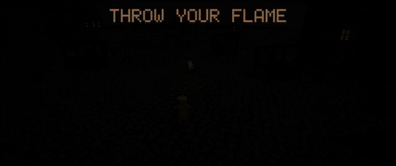
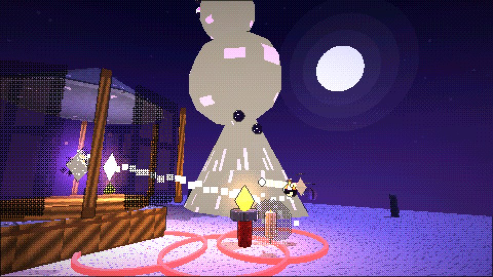
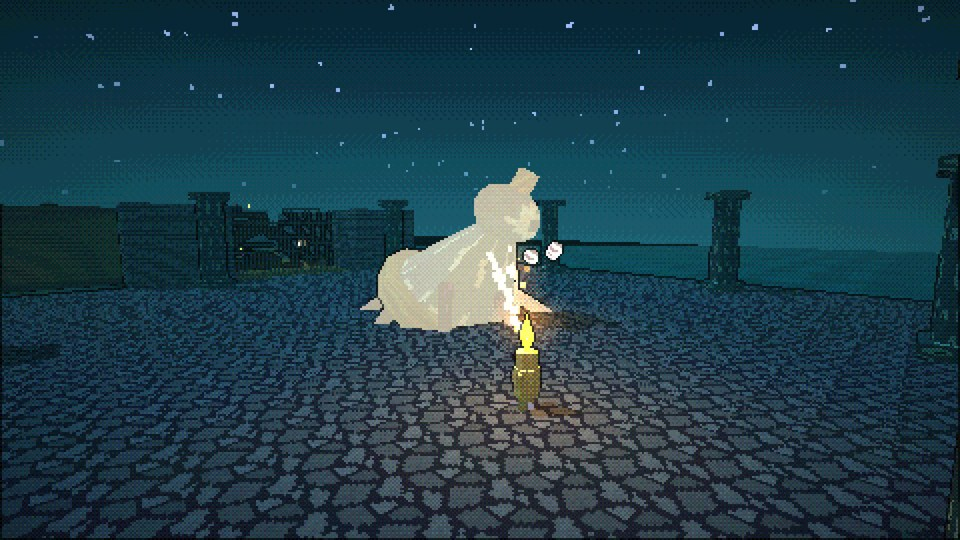
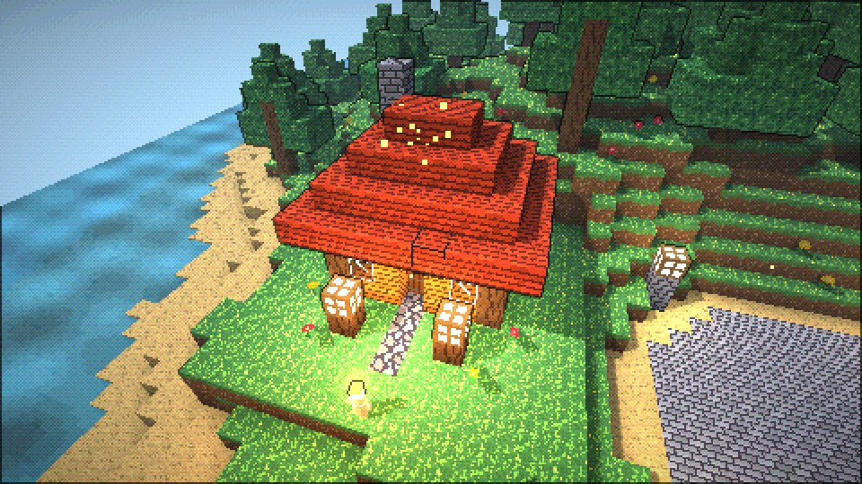
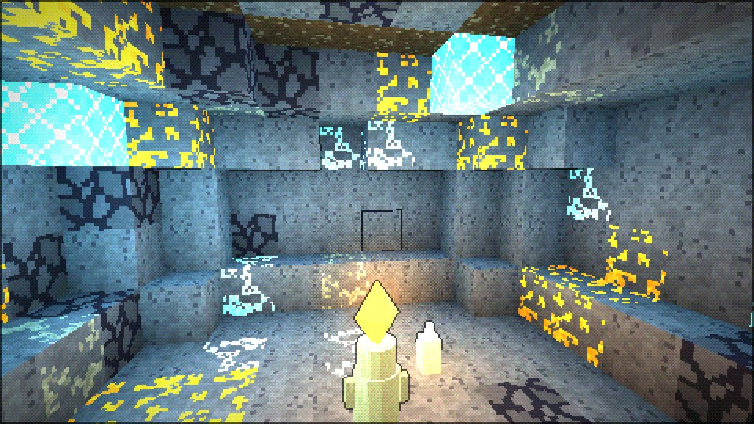

# WICKLIGHT

*Your head is the last flame in the world. Throw it.*



**[Download the AppImage](https://github.com/rxvy-dev/wicklight/raw/main/download/Wicklight-x86_64.AppImage)** (free, x86_64 Linux) · or build it: `git clone https://github.com/rxvy-dev/wicklight && cd wicklight && ./build.sh run`

| | |
|---|---|
|  |  |
|  |  |

🏕️ **Try [Cabin Camping](https://thecheezekneez.itch.io/cabin-camping) too!** A free retro horror game by my friend CheezeKneez, about a camping trip where something might be following you (Windows & Linux).

A native Linux 3D pixel-art action-adventure written in C++17 with SDL2 and OpenGL 3.3. No browser, no Electron, no engine runtime, and no asset files: every texture, model, sound effect and music track is generated in code.

## The game

Lumen Hollow forgot what night was. The Great Lamp at the top of the Lighthouse Spire burned brighter every year, until one evening it went out. Then the **Hush** came down the Spire like water and drank the light from every window.

You play **Wick**, a small wax automaton lit by Marrow, the last Lamplighter. Your head is a living flame, and the whole game is built around it:

| Power | How you get it | What it does |
|---|---|---|
| **Throw / Recall** | start | Throw your flame to burn enemies and light braziers. Recall it and it burns everything on the way back too. You can hit a shielded knight in the back this way. |
| **Dash** | start | A quick burst. You can't be hurt mid-dash. |
| **Warp** | beat the Drowned Bellwether | Step into your thrown flame: across gaps, up cliffs, onto brass hooks. |
| **Bloom** | beat GL1TCH the hacker | Detonate the flame wherever it is. Melts wax seals, lights groups of braziers, clears swarms. |
| **Sunflare** | beat the Veil Matron | Hold to charge: longer range, triple damage. Shatters shields, crystal and shadow shrouds. |
| **Overclock** | beat GL1TCH the hacker | Every hit you land charges it. When it's full, slow the whole world to a crawl for a few seconds while you keep full speed. |
| **Firewall** | crack GL1TCH's server room (Clockwood, optional) | Drop a wall of fire. Enemies can't walk through it and burn while they try, shots melt in it, and it lights braziers. |
| **Ember Grapple** | survive Lumen City (the FBI level) | Throw your flame onto a brass hook and hold Grapple: a rope of fire pulls you in. Steer to swing, let go to fling yourself. |

**New in 1.1:**
- **Lumen City, "Wick is wanted":** after GL1TCH, the FBI thinks Wick is the hacker. Sneak and fight through a night city: sweeping searchlights call in backup, agents with flashlights spot you and fire, a hacked police barricade, a climb up a tower's fire escapes, a rooftop ambush, and a 30-second last stand on a helipad until Sprocket's rescue chopper lands. Through GL1TCH's backdoor, a door on the east side of his arena in the Clockwood that opens once he's beaten. Every so often a depth of the Endless Dark is an **FBI raid** in Lumen City too.
- **A better hacker level:** GL1TCH's gates are now **hacking puzzles**: terminals flash a sequence, and you burn them in the same order. A wrong guess calls in **firewall drones**. The Clockwood is full of code screens and falling data, the screen glitches, and **viruses** (green bugs that copy themselves when burned) crawl around. GL1TCH himself now teleports between his servers, fires fans of code bolts, sends **fake Wicks** that run at you and explode, and sweeps glitch lines across the arena in turbo mode.
- **Side jobs in the Hollow:** find Mira's cat Whiskers (he's stuck in a treehouse), relight Old Fenn's six street braziers, race Flick through 12 rings of candlelight (bronze, silver, gold), and catch Gil's **Golden Carp** with the new **fishing** minigame at the Wharf (4 kinds of fish).
- **Fun forever:**
  - **The Gauntlet** (red arch in the south-west corner of the Hollow): an arena of endless waves with a cheering crowd. Every wave can roll a wild modifier - SWARM, SPEED DEMONS, MOTH STORM, ROBOT RUMBLE, FBI RAID, GLITCH STORM, LOW GRAVITY, KABOOM (everything explodes), GOLD RUSH, TANKS - and every 5th wave brings a mini-boss. Fireworks when you clear one; your best wave is saved.
  - **The Rising Dark** (the arch in the south-east corner of the Hollow, needs Warp): an endless tower of platforms spiralling into the night while the Hush's tide rises underneath, faster and faster. Jump, warp to hooks, ride the lifts and grapple. A new tower every run; your best height is saved and every run pays embers.
  - **Fishing**: walk up to a fishing post on a dock (the Sunken Wharf, or the Hollow's west docks) and press E to cast. Wait for the splash and "!! BITE !!", press E quickly, then press E again when the white needle is inside the green zone.
  - **The Toy Box** (pause menu): silly modes you can mix any time - Big Head Wick, Tiny Wick, Moon Gravity, Party Mode (confetti and disco lights), Kaboom (chain-reaction explosions), Turbo Wick, Endless Bloom, Giant Flame, Jelly Enemies, Slow-Mo Kills.
- **Things to do forever (after the ending):**
  - **Daily bounties:** the **Night Board** by the Spire posts 3 new bounties every day (burn enemies, land combos, catch fish, clear depths, smash urns, light braziers, beat bosses, collect embers, win races). 150 embers each, plus 300 for clearing the whole board.
  - **Boss Rush:** the **Echo Statue** by Marrow's workshop wakes all five bosses, tougher, back to back against the clock. Die and the rush is over. Your best time is saved.
  - **Flame dyes:** Wren sells coloured fire for embers: Azure, Verdant, Violet, Rose, Ghostly, Molten Gold and Rainbow (5000 embers). Your flame, its glow and its light all change colour.
  - **30 trophies:** shards, candles, hats, fish, race gold, side jobs, Endless depths 10/25/50, an FBI raid, 20- and 50-hit combos, 500 and 2000 enemies burned, a no-hit boss win, a sub-5-minute Boss Rush and more. The Journal's second page (Left/Right in the Journal) shows them with your bounties and stats.
- **Hats:** 10 cosmetic hats. Some are quest rewards, the rest hide in secret spots in every region. Swap them at the mirror in Marrow's workshop.

**Campaign:** the hub, Lumen Hollow, then four regions, each ending in a boss fight: the Sunken Wharf, the Clockwood (GL1TCH, a hacker from across the world), the Ashen Vaults and the Junkyard of Lost Machines (King Rattletrap). Their four Beacon-Hearts open the Lighthouse Spire, where the final fight against the Hush leads to a full ending. After the credits you can keep exploring.
**Embers, combos and upgrades:** enemies and breakable urns drop embers. Chain hits without getting hurt to build a combo, which multiplies your embers up to x4. Spend them at any lit lantern (walk up and press E):

| Upgrade | Effect |
|---|---|
| Thicker Wax | more health |
| Hotter Flame | +50% damage per level |
| Swift Wick | faster, longer throws |
| Second Wind | double jump |
| Ember Magnet | pull embers in from farther away |
| Wide Bloom | bigger blooms that recharge faster |

There aren't enough embers in one clean run to buy everything, so playing well pays.

**Bosses and mini-bosses (7):**
- The Drowned Bellwether
- the Gloom King (mini-boss)
- GL1TCH the hacker
- the Veil Matron
- MEGA-BOT 3000 (mini-boss)
- King Rattletrap
- the Hush

**Robot friends:** Sprocket's stall in the hub sells robots for embers. 2 can follow you at once, or 3 after you earn the Junkyard's Spark Core.

| Robot | Cost | What it does |
|---|---|---|
| SPARK | 80 | shoots fireballs at enemies |
| MAGS | 50 | vacuums up embers and wax |
| PATCH | 120 | heals you |
| BUBBLES | 150 | blocks a hit every 12 s |
| BOOMER | 200 | lobs firebombs into groups |

**Characters:** Marrow the Lamplighter, Sprocket the robot-maker, Pip the ghost kid, Gil the fisher, Tilda the clockmaker, Mort the gravekeeper and Rusty the scrap robot. Talk to each of them: the first chat comes with a gift of embers.

**Secrets:** 10 Memory Candles tell the story of what really happened to the Lamp. 7 Ember Shards raise your maximum health, and some of them are only reachable with powers you earn later.
**The Endless Dark (infinite levels):** a dark portal east of the Spire in Lumen Hollow (open once you've talked to Marrow). Every depth is a new level built from its number, so retrying a depth gives the same level, and there is no last depth.
- Levels mix ambush rooms, stepping stones, warp gaps, brazier gates, treasure rooms and cliff climbs (the warp pieces only appear once you have Warp).
- Each depth adds rooms and enemies, and enemies get tougher (capped, so it stays fair). Every 5th depth is a guardian fight: the Bellwether, GL1TCH and King Rattletrap take turns.
- Clearing a depth pays embers plus **wood and stone**. Every 3rd depth adds crystal, every 5th adds gears. Your best depth is saved, and you always continue from your deepest point.
- The portal at the start of each depth takes you back to the Hollow.

**Wick's Island (a block world):** clear **10 depths** and a green portal west of the Spire opens to your own island. The whole island is made of blocks, and you can dig up and build on all of it.
- **Mine** any block: grass, dirt, stone, sand, logs, leaves, and ores hidden in the caves. **Ember ore** pays out embers, **crystal ore** gives crystals and **scrap ore** gives gears.
- **Place** blocks anywhere, and **craft** at a Workbench or Furnace: planks, stone bricks, marble, glass, roof tiles, six colours of wax blocks, lamps, glow crystals, metal and more.
- **Blocks you can use:**
  - **Bed:** sleep through the night and respawn there.
  - **Door:** two blocks tall, opens and closes.
  - **Chest:** stores your stuff.
  - **Ladder:** climb it.
  - **Jump Pad:** launches you into the air.
  - **Ember Bomb:** light it and run; it blasts out a crater.
  - **Lamp / Candle / Glow Crystal:** real lights that keep gloomlings away.
  - **Ember Forge:** makes embers while you're on the island.
  - **Sapling:** grows into a tree.
- **Day and night:** a full day lasts 10 minutes. At night gloomlings creep out of the dark away from lights: fight them with your flame (slot 1), wall yourself in, or sleep. Sunrise burns them away, and they drop wax that crafts candles and wax blocks.
- **Bramble** the beaver gives you a starter kit and sells blocks, beds, lamps, bombs and more for embers. Endless Dark levels also pay out logs, stone, crystals and gears.
- You can swim in the sea around the island. Everything you change is saved (only the changed blocks are stored, so saves stay small).

**Enemies:**
- Gloomlings: they lunge at you.
- Tarbells: lobbing turrets that shell up when you get close.
- Moths: they smother a thrown flame.
- Hushknights: shielded and must be hit from behind.
- Wraiths: invisible unless your flame is near.
- Viruses: green bugs that split in two when burned.
- Firewall drones: hover around you and fire straight code bolts (your flame burns the bolts).
- Fake Wicks: GL1TCH's decoys. They run at you and explode.
- FBI agents: patrol with flashlights, chase you once they spot you, and fire after a red laser warning.

## Install

**From source** (any distro; needs git, a C++ compiler and SDL2):
```sh
git clone https://github.com/rxvy-dev/wicklight
cd wicklight
./build.sh run        # build and play right away
./build.sh install    # add Wicklight to your app launcher (~/.local, no root)
```
Wicklight then appears in your app launcher (the menu entry uses the full path, so it works without any PATH setup).
To also type `wicklight` in a terminal, add `~/.local/bin` to your PATH:
`echo 'export PATH="$HOME/.local/bin:$PATH"' >> ~/.bashrc` (or your shell's rc file).
`./build.sh uninstall` removes it and keeps your saves. To update later: `git pull && ./build.sh install`.

**AppImage** (no build needed): download [Wicklight-x86_64.AppImage](https://github.com/rxvy-dev/wicklight/raw/main/download/Wicklight-x86_64.AppImage), then `chmod +x Wicklight-x86_64.AppImage && ./Wicklight-x86_64.AppImage`

## First steps in the game
- A one-line **tutorial** (top left) walks you through looking, moving, jumping, dashing, throwing and recalling your flame.
- The **GOAL** box (top right) always says what to do next.
- **How to play** is on the title screen and in the pause menu (Esc).

## Quick start

```sh
git clone https://github.com/rxvy-dev/wicklight
cd wicklight
./build.sh run        # build and play (needs a C++17 compiler + SDL2 runtime)
```

Or download a ready-made build, no compiling needed:

- **AppImage:** [Wicklight-x86_64.AppImage](https://github.com/rxvy-dev/wicklight/raw/main/download/Wicklight-x86_64.AppImage), then `chmod +x Wicklight-x86_64.AppImage && ./Wicklight-x86_64.AppImage`
- **tar.gz:** [wicklight-linux-x86_64.tar.gz](https://github.com/rxvy-dev/wicklight/raw/main/download/wicklight-linux-x86_64.tar.gz), extract it, then run `./wicklight` inside the folder.

### Requirements
- x86_64 Linux, X11 or Wayland session
- OpenGL 3.3 (any Mesa from the last decade, NVIDIA or AMD driver)
- **SDL2 runtime**. It's loaded at startup, so a missing SDL2 gives a clear message instead of a crash. Release builds bundle a fallback copy, but your system's SDL2 is preferred.

| Distro | SDL2 runtime | Build tools |
|---|---|---|
| Arch / Manjaro / EndeavourOS | `sudo pacman -S sdl2` (or `sdl2-compat`) | `base-devel` |
| Debian / Ubuntu / Mint / Pop | `sudo apt install libsdl2-2.0-0` | `build-essential` |
| Fedora | `sudo dnf install SDL2` | `gcc-c++` |
| openSUSE | `sudo zypper install libSDL2-2_0-0` | `gcc-c++` |
| Void | `sudo xbps-install SDL2` | `base-devel` |
| Gentoo | `sudo emerge media-libs/libsdl2` | (system gcc) |
| NixOS | `nix run github:rxvy-dev/wicklight` or `nix build` | flake provided |

SDL2 *development* headers are **not** needed to build: they're vendored in `third_party/include`.

## build.sh

| Command | What it does |
|---|---|
| `./build.sh` | Build `build/wicklight` with your system compiler (`CXX=clang++` to switch). |
| `./build.sh run [args]` | Build, then play. |
| `./build.sh test` | Build, then run the headless full-campaign autoplay test. |
| `./build.sh release` | Portable build into `dist/`: a folder, a `.tar.gz`, and an AppImage when `appimagetool` is available or downloadable. Uses zig (`pip install ziglang`) to target glibc 2.17 with a static libc++, and falls back to your compiler with a static libstdc++. |
| `./build.sh install` / `uninstall` | Install to `~/.local`: the command, a menu entry and the icon. |
| `./build.sh clean` | Delete `build/` and `dist/`. |

**CMake** also works: `cmake -B build-cmake && cmake --build build-cmake`.
**Flatpak:** `packaging/io.github.rxvy_dev.Wicklight.yml` (build instructions are inside it).
**NixOS:** `flake.nix` (`nix run`, `nix build`, `nix develop`).

## publish.sh

```sh
gh auth login             # once
./publish.sh              # create github.com/rxvy-dev/wicklight if needed, commit, push
./publish.sh --release    # also build dist/ and upload a v1.0.0 GitHub release
```
Overrides: `GH_USER=... REPO=... ./publish.sh --private`.

## Controls

| Action | Keyboard / mouse | Gamepad |
|---|---|---|
| Move | WASD | Left stick |
| Camera | Mouse | Right stick |
| Jump | Space | A |
| Dash | Left Shift | B |
| Throw / Recall (hold to charge Sunflare) | Left mouse | RT |
| Warp | Right mouse | LT |
| Bloom | Q | RB |
| Ember Grapple (hold) | F | Y |
| Firewall | R | Left stick click |
| Overclock | C | Right stick click |
| Interact / talk | E | X |
| Journal | Tab | Back |
| Pause | Esc | Start |
| Fullscreen / screenshot | F11 / F12 | |

**On Wick's Island:** hold **Throw** (left mouse) on a block to mine it, and press **Warp** (right mouse) to place the block you're holding, or to use a bed, door, chest, workbench, furnace or bomb. **1-9** or the mouse wheel (LB on a gamepad) pick the hotbar slot; slot 1 is your flame, for fighting. **Journal** (Tab) opens your inventory and crafting there; in that screen, Enter holds an item, 2-9 puts it on a hotbar slot, and Bloom (Q) crafts 5 at once. **E** also uses the block you're aiming at.

All keys can be rebound in **Settings → Controls**. Settings also cover UI size, volume, mouse sensitivity, invert Y, pixel resolution (180–540 lines), shadows, outlines, field of view, screen shake, aim assist, fullscreen and VSync.

## How to beat it (spoilers)

1. **Hub:** talk to Marrow, then take the west steps to the **Sunken Wharf**. Learn to throw and recall, cross the stepping stones, and light the two timed braziers quickly.
   - **Boss, the Drowned Bellwether:** jump the shockwave rings. When it tolls and tilts, throw into its glowing core.
2. **Clockwood:** go north across the broken bridge by throwing, then warping. Climb the great tree hook by hook.
   - **Hacked terminals:** watch the order the screens flash (each has its own colour stripe and sound), then throw your flame into them in that order. A wrong one sends firewall drones and replays the sequence. Left of the lantern after the terminals is GL1TCH's server room: a 5-terminal puzzle that gives you **Firewall**.
   - **Boss, GL1TCH the hacker** (from across the world, paid by the Hush): throw your flame into his 3 glowing SERVERS. Two hits each, or one Bloom. With all three burned, his FIREWALL crashes: burn him while he reboots. Destroy the green data packets and code bolts with your flame, step out of the green DDoS markers, and burn fake Wicks before they reach you. Beating him also gives you **Overclock**.
3. **Ashen Vaults:** go east and Bloom the wax seal. Knights must be hit from behind, and Bloom clears moth swarms.
   - **Boss, the Veil Matron:** light all four braziers. Bloom between each pair to light two at once. She falls dazzled: hit her then.
4. **Junkyard** (south-west gate, after the Vaults): buy a robot friend first! Burn rats in packs. Get behind MEGA-BOT 3000 and hit its glowing vents. Light the three furnaces quickly.
   - **Boss, King Rattletrap:** step out of the claw's shadow. When the claw is STUCK, the cockpit opens: burn the rat.
5. **Spire:** set the four hearts in the pedestals at the Spire door. Wraiths show only near your flame. Shatter the crystal with a Sunflare, climb the outside, and ride the lift to the summit.
   - **Boss, the Hush:** a Sunflare burns the shroud off a slammed-down hand, so you can hit its eye. Then Bloom the three sealed wicks to open the Lamp and strike the heart. When it flees, finish it.

6. **Lumen City** (any time after GL1TCH; the door on the east side of his arena in the Clockwood): keep out of the searchlight pools and burn agents from behind. Hack the barricade's three traffic boxes, then throw-and-warp up the tower's fire escapes. Clear the rooftop, cross the bridge, and survive 30 seconds on the helipad (Firewall and Overclock help a lot). Sprocket brings the **Ember Grapple**.

Lanterns are checkpoints: they restore your flame and save. Each region entrance also saves.

**Side jobs:** Mira (west of the plaza) lost her cat: throw to the hook by the treehouse and warp up. Old Fenn (north of the Spire) wants six street braziers lit around the edge of the Hollow. Flick (next to Fenn) runs the candle race: dash a lot, gold is under 14 seconds. Gil asks for the Golden Carp once you've met him: use the fishing posts on the Wharf docks, press E when it bites, then again when the needle is in the green.

**After (or during) the campaign:** take the dark portal east of the Spire into the Endless Dark. Falling costs 1 wax and puts you back on the last ledge you stood on, so take your time on the stepping stones. Clear 10 depths to unlock Wick's Island through the portal west of the Spire. There, talk to Bramble for a starter kit, put your bed down before the first night, and dig: the caves under the hills are full of ore.

## Saves and settings
- Save: `$XDG_DATA_HOME/wicklight/save.dat` (default `~/.local/share/wicklight/save.dat`)
- Settings: `$XDG_CONFIG_HOME/wicklight/settings.cfg` (default `~/.config/wicklight/settings.cfg`)
- `WICKLIGHT_DATA_DIR=/some/dir` puts both somewhere else.

Writes are atomic: the game writes a temp file, then renames it. A damaged or truncated save is moved to `save.dat.corrupt`, and the game says so on the title screen instead of crashing. Nothing needs root.

## Testing: what was actually verified

- **Full campaign, automated:** `./build.sh test` plays a fresh save from New Game through the real game simulation (same physics, flame, enemies, bosses, gates, saves) to the ending and victory screen. It checks every gate, ability, boss, Beacon-Heart and all 10 Memory Candles, then does a save/load round trip. **Result: PASS.** The bot aims perfectly and follows scripted routes. It runs in god mode, so it can't die but still counts would-be hits; it took 13 across the campaign.
- **Bosses with real damage:** `./build.sh test` also fights each boss with damage on, at base health and no upgrades. The bot beats all four. Separately, with damage on for the whole campaign (`WICKLIGHT_MORTAL=1`), the bot dies at the first boss. It times the shockwave jumps poorly, and its script can't find its way back after a respawn. A test also confirms you can't warp past a closed gate. Human difficulty has only been checked by the bot.
- **Endless Dark, automated:** `./build.sh test` also plays generated depths 1–30 back to back, using the route each level records when it is generated. **Result: 30/30 cleared, island unlocked.** It also plays depths 1–8 without Warp: 8/8. A longer manual run of depths 31–60 cleared 59/60; the one miss was the bot running out of time in an ambush room. That depth cleared when replayed alone. Each depth is a different random layout, so depths past 60 haven't been played.
- **Wick's Island, automated:** `./build.sh test` runs 21 checks through the real game update:
  - the generated island (hills, sea, trees, ores);
  - mining and placing with the actual mouse buttons, and number-key hotbar selection;
  - placed blocks being solid, and refusing to place a block inside yourself;
  - doors opening and closing (and walking through an open one);
  - crafting at the workbench, and a chest returning its contents when broken;
  - climbing a ladder, the jump pad, the ember bomb crater, and swimming;
  - gloomlings spawning at night and burning at sunrise;
  - sleeping through the night and respawning at the bed;
  - a sapling growing into a tree;
  - a save/load round trip, and refunds for old blueprint saves.

  **Result: 21/21 OK.** The look was checked in screenshots, but nobody has played it by hand yet, so it still needs human playtesting.
- **Real executable:** launched and rendered under Xvfb with Mesa llvmpipe (software OpenGL 4.5) on Ubuntu 24.04. Screenshots of the title screen and all five areas were checked. There was no audio device there, so sound was **not** heard: the game detected that and continued silently.
- **Portable build:** the zig-built release binary needs only glibc ≥ 2.16 (no libstdc++) and also passed the full autoplay test.
- **Not tested:** real GPUs, Wayland, gamepads, and every distro other than Ubuntu 24.04. Arch, Fedora, openSUSE, Mint, Void, Gentoo and NixOS are *expected* to work given the portable build, but weren't run. The Flatpak manifest and Nix flake were written but not built here (no flatpak-builder / nixpkgs access).

## Project layout
```
src/            game source (C++17)
  main.cpp        window, input, main loop
  platform.*      runtime SDL2/OpenGL loading + friendly errors
  render.*        pixel renderer: low-res target, lighting, shadows, dither, outlines, UI
  textures.cpp    procedural pixel-art texture atlas
  audio.*         software synth: sound effects + generative music
  game.*          progression, saves, settings, story, cinematics
  level.cpp       collision grid, swept movement, level builder
  levels.cpp      the hand-made areas
  endless.cpp     the Endless Dark level generator
  voxel.*         the block world: island generator, chunk meshes, block collision + ray casts
  home.cpp        Wick's Island gameplay: mining, placing, usable blocks, crafting, day/night, shop
  bots.cpp        robot companions + Sprocket's shop
  player.cpp      Wick, the flame, camera, aiming
  enemies.cpp     enemies, projectiles, hazards
  bosses.cpp      the bosses
  draw.cpp        models and effects
  ui.cpp          menus, HUD, journal
  bot.cpp         autoplay tests (campaign, bosses, endless, island)
third_party/include   vendored SDL2 + OpenGL headers
packaging/      .desktop, icon, Flatpak manifest
build.sh  publish.sh  CMakeLists.txt  flake.nix
```

MIT licensed. Made by rxvy (github.com/rxvy-dev).
